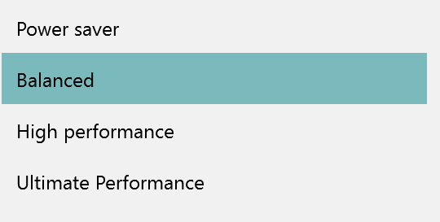
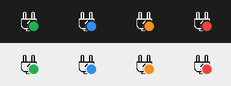
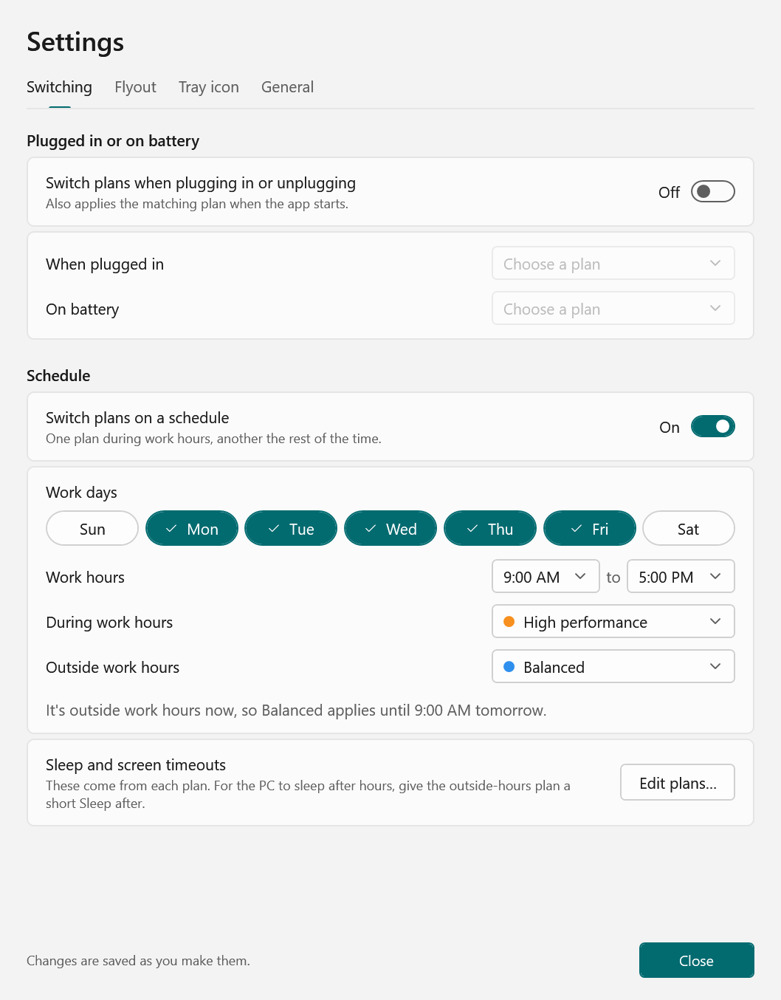
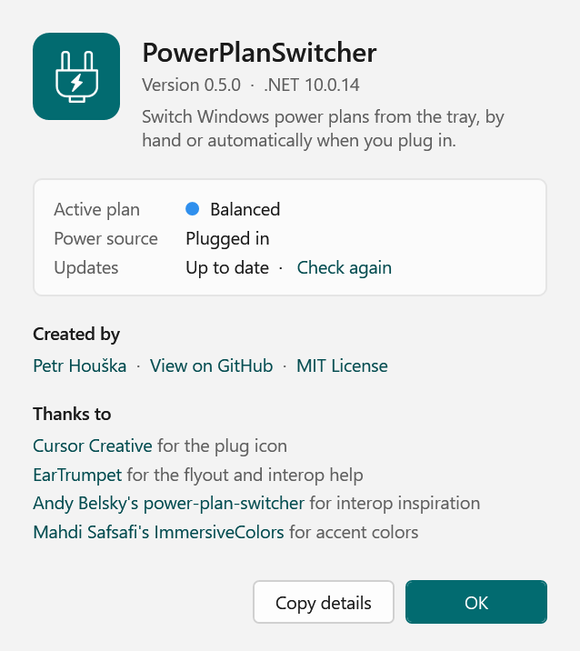
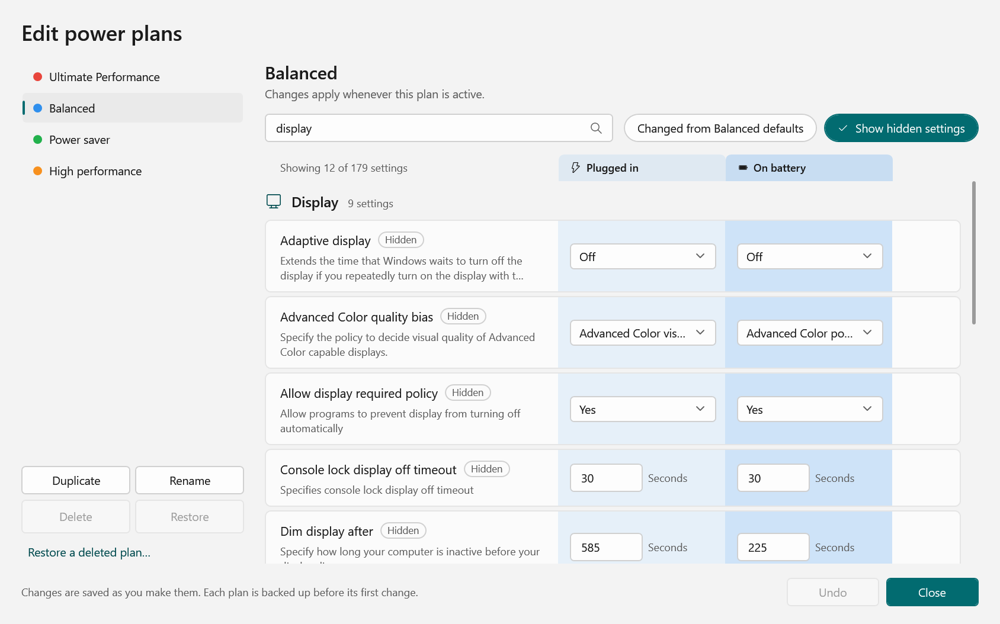
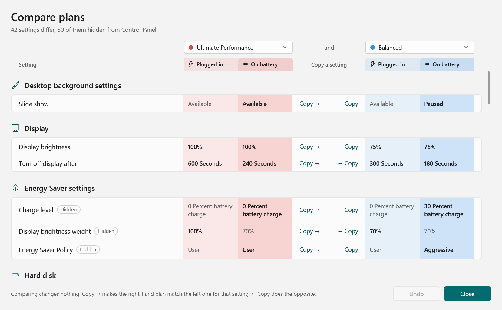

# PowerPlanSwitcher

[](https://github.com/ChangemakerStudios/PowerSwitcher/releases/latest)
[](https://github.com/ChangemakerStudios/PowerSwitcher/actions/workflows/build.yml)

Switch Windows power plans from the tray — by hand, or automatically when you plug in or unplug.

<p>
  <picture>
    <source media="(prefers-color-scheme: dark)" srcset="ReadmeAssets/flyout-dark.png">
    
  </picture>
</p>

The tray icon carries a coloured dot for the active plan, so you can tell at a glance what you're running:



## Features

- **Quick switching** — click the tray icon for a Windows-style flyout of your power plans. It works from the keyboard too, and can be limited to the built-in plans.
- **The active plan at a glance** — a coloured dot on the tray icon, one colour per plan. Pick each plan's colour, and the order plans are listed in, in Settings.
- **Automatic switching** — choose one plan for when you're plugged in and another for battery.
- **Work-hours schedule** — one plan during your work days and hours (say, High performance) and another the rest of the time (say, Balanced, set to sleep sooner).
- **Edit any plan** — every setting, including the ones Windows hides, with plugged-in and battery values side by side. Search, see what's changed from the defaults, and reset it.
- **Compare plans** — see only the settings that differ between two plans, and copy a setting across.
- **Manage plans** — duplicate, rename and delete plans, with a backup of each plan before its first change.
- **Keyboard shortcut** — open the flyout from anywhere (Shift+Win+L by default, configurable).
- **Fits in** — follows the Windows light, dark and high-contrast themes and your accent colour, switching live.
- **Notices outside changes** — switching plans in Control Panel or with `powercfg` updates the tray straight away.
- **Starts with Windows** and **keeps itself up to date**.

## Install

Download **`PowerPlanSwitcher-win-x64-stable-Setup.exe`** from the [latest release](https://github.com/ChangemakerStudios/PowerSwitcher/releases/latest) and run it — or the `-win-arm64-` one on an Arm PC. It installs for your user account, adds a Start menu shortcut and starts with Windows. If the .NET 10 Desktop Runtime is missing, Setup installs that first (which Windows may ask you to approve).

> **"Windows protected your PC"?** The installer isn't code-signed yet, so SmartScreen may warn about it. Choose **More info → Run anyway**.

Prefer not to install? The `-Portable.zip` runs from any folder.

**Updates:** PowerPlanSwitcher checks GitHub shortly after it starts and every 12 hours, downloads new versions in the background, and offers **Restart to update** in the tray menu and the About window. Otherwise the update is applied the next time it exits.

**Uninstall** from Windows Settings → Apps → Installed apps.

**Coming from the Microsoft Store version?** That's a separate app — uninstall it so the two don't both sit in the tray, then set your preferences again in Settings.

## Settings

Right-click the tray icon → **Settings…**. Changes apply and save immediately (to `%LOCALAPPDATA%\Petrroll\PowerSwitcher\PowerSwitcherSettings.xml`, which survives updates). The tabs are **Switching** (plugged in or on battery, and the schedule), **Flyout**, **Plans** (their order and tray colours) and **General**.

**The schedule** switches plans when your work hours start and end. Work hours can run past midnight. If you pick a plan by hand, it stays until the next start or end. After the PC wakes from sleep, the app catches up if one passed while it was asleep. If you also switch by power source, the battery plan still wins on battery. Whether the PC sleeps after hours depends on the outside-hours plan's **Sleep after** setting, which you can change in the editor.

<p>
  <picture>
    <source media="(prefers-color-scheme: dark)" srcset="ReadmeAssets/settings-dark.png">
    
  </picture>
  &nbsp;
  <picture>
    <source media="(prefers-color-scheme: dark)" srcset="ReadmeAssets/about-dark.png">
    
  </picture>
</p>

## Edit power plans

Right-click the tray icon → **Edit power plans…**, or **Edit…** in Settings. Pick a plan on the left to see all its settings, grouped like Control Panel's advanced power options but with nothing hidden. Plugged-in and battery values sit side by side, tinted in the plan's colour.

<p>
  <picture>
    <source media="(prefers-color-scheme: dark)" srcset="ReadmeAssets/editor-dark.png">
    
  </picture>
</p>

- **Search** by name or description. **Show hidden settings** adds the ones Windows keeps out of Control Panel, which are usually most of them.
- **Changed from defaults** shows only what's been changed, each with its default underneath and a **Reset** button.
- Changes save as you make them and take effect straight away on the active plan. **Undo** reverses them until you close the window.
- Each plan is backed up before its first change (to `%LOCALAPPDATA%\Petrroll\PowerSwitcher\Backups`). **Restore** puts a plan back as it was, and **Restore a deleted plan…** brings back one you've deleted.

Windows won't let two settings be changed without administrator rights: "Require a password on wakeup" and one processor core parking setting. The editor says so if you try.

### Compare plans

Right-click the tray icon → **Compare plans…** to see only the settings that differ between two plans. **Copy →** makes the right-hand plan match the left one for that setting, and **← Copy** does the opposite.

<p>
  <picture>
    <source media="(prefers-color-scheme: dark)" srcset="ReadmeAssets/compare-dark.png">
    
  </picture>
</p>

## Building

Requires the .NET 10 SDK.

```powershell
dotnet build PowerSwitcher.sln     # just compile
.\build.ps1                        # build and package the x64 and Arm64 installers into .\releases
```

See [RELEASING.md](RELEASING.md) for versioning, branches and how releases are published.

## Credits

PowerPlanSwitcher was created by [Petr Houška](https://github.com/petrroll/PowerSwitcher) — if you like it, feel free to [buy him a beer](https://www.paypal.com/cgi-bin/webscr?cmd=_donations&business=houskape%40gmail%2ecom&lc=CZ&item_name=PowerPlanSwitcher&item_number=042&currency_code=USD&bn=PP%2dDonationsBF%3abtn_donate_SM%2egif%3aNonHosted). This fork is maintained by [Changemaker Studios](https://github.com/ChangemakerStudios).

Special thanks to:
- Icon made by [Cursor creative](http://www.flaticon.com/authors/cursor-creative) from [flaticon.com](http://www.flaticon.com/)
- [EarTrumpet](https://github.com/File-New-Project/EarTrumpet) for the flyout, interop stuff, and some other help :)
  - David Golden (@GoldenTao)
  - Rafael Rivera (@WithinRafael)
- [Andy Belsky's power-plan-switcher](https://github.com/andy722/power-plan-switcher) for some interop inspiration
- [Mahdi Safsafi's ImmersiveColors](https://github.com/MahdiSafsafi/ImmersiveColors) for making working with undocumented accent colors easy :)

## License

[MIT](LICENCE)
